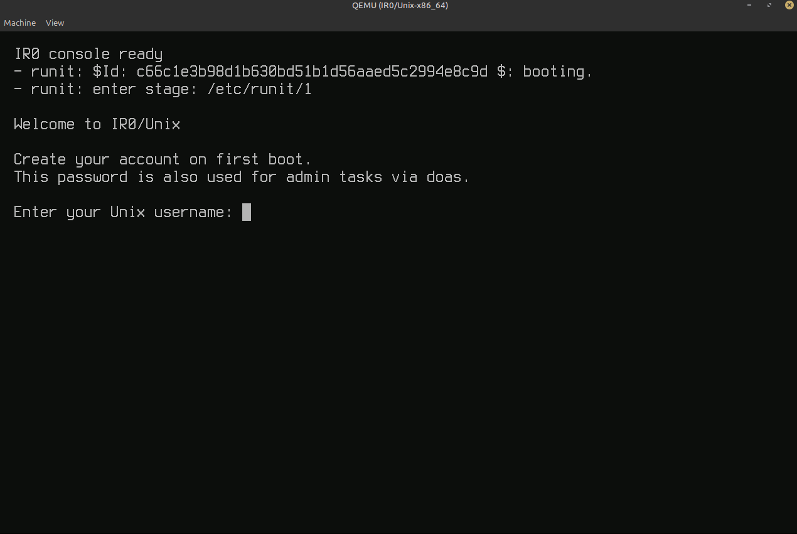
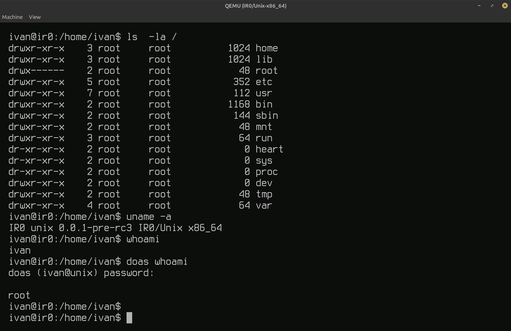
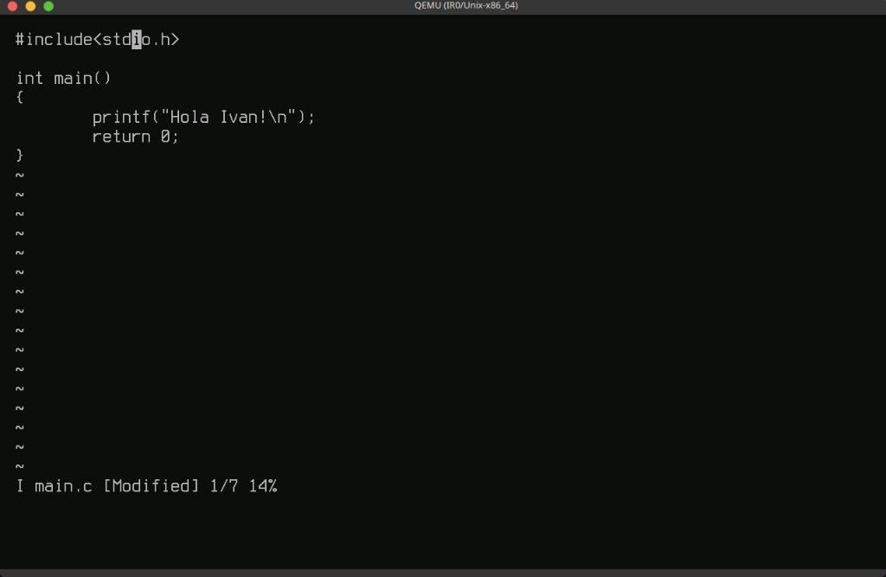
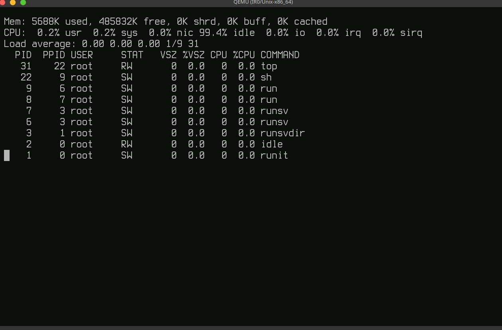
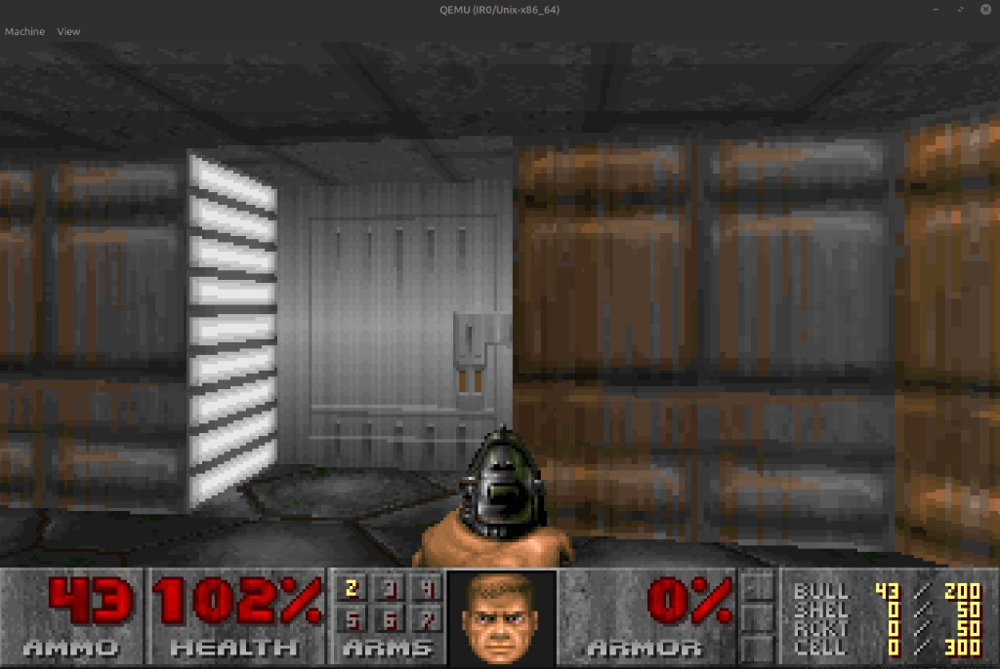
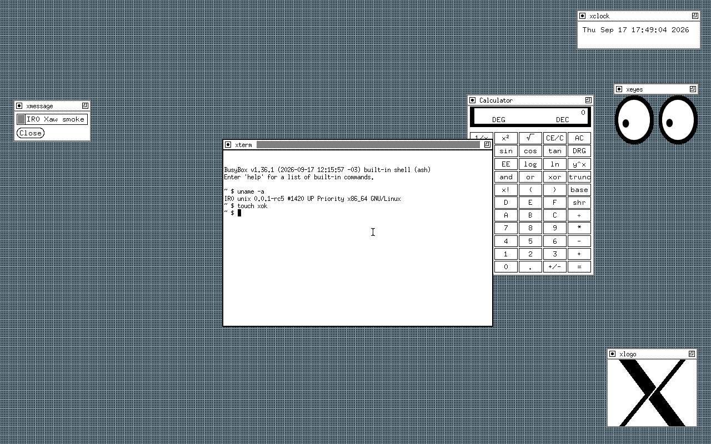
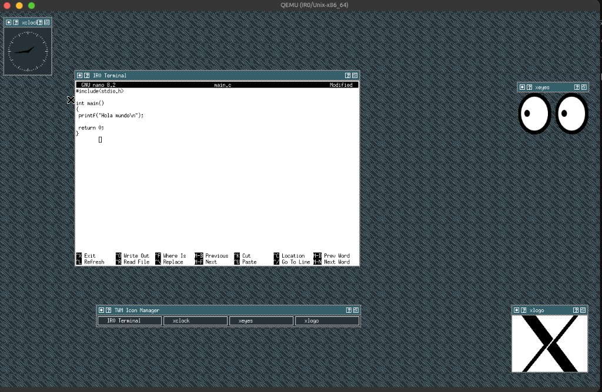
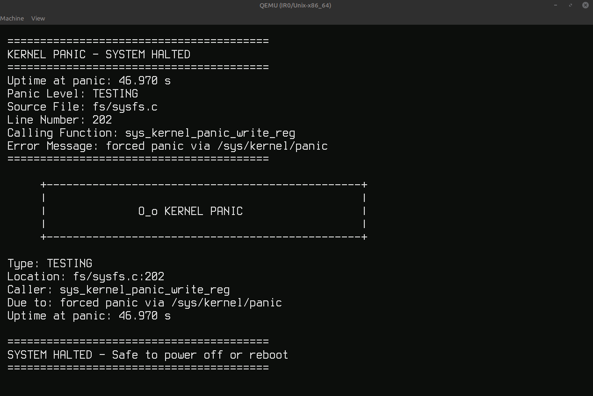

<p align="center">
  
</p>

<h1 align="center">IR0 Kernel</h1>

<p align="center">
 Unix-like kernel (GPL-3.0) — x86-64 and ARM64 bring-up under QEMU, narrow
 facades, partial Linux ABI.
</p>

  IR0 is an operating-system kernel (GPL-3.0). Primary bring-up target is
  **x86-64** under QEMU (Multiboot, GRUB, VFS/MINIX, ELF userspace); **ARM64**
  covers QEMU `virt` and Raspberry Pi 3/4/5 board images. Version string:
  **`0.0.1-rc6`** (last pre-release before `v0.0.1` final).

## Kernel and userspace

The kernel tree builds the kernel and its boot artifacts. The finished
userspace — runit PID 1, BusyBox, login, packages, rootfs, and `disk.img` —
lives in the sibling [`ISD`](https://github.com/IRodriguez13/ISD) repository.

| Layer | Role |
|-------|------|
| **IR0** (this tree) | mechanisms, drivers, UAPI, kernel ISO / board images |
| **ISD** (separate repo) | packages, services, rootfs, `disk.img` |

The IR0 Makefile does **not** clone, build, or pack ISD. `make run` only boots
an artifact that is already on disk; attach a userspace image with `DISK=…`
when you have one. Without `/sbin/init` on a disk the kernel **panics** at the
handoff — there is no in-kernel fallback shell.

### Screenshots (ISD userspace on QEMU)

<p align="center">
  
</p>

<p align="center"><em>First boot: runit stage1 → account wizard (password also used for doas).</em></p>

<p align="center">
  
</p>

<p align="center"><em>Logged-in shell: Unix hierarchy, <code>uname -a</code>, privilege elevation with <code>doas</code>.</em></p>

<p align="center">
  
</p>

<p align="center"><em>BusyBox <code>vi</code> on the ISD rootfs (QEMU GTK).</em></p>

<p align="center">
  
</p>

<p align="center"><em>BusyBox <code>top</code>: runit PID 1, <code>runsvdir</code>/<code>runsv</code>, ash, and idle.</em></p>

<p align="center">
  
</p>

<p align="center"><em>Doom on IR0/Unix: framebuffer + input path.</em></p>

<p align="center">
  
</p>

<p align="center"><em>Upstream X11 session on IR0 (TinyX/Xfbdev, twm, xterm, Xaw clients). Terminal shows <code>uname -a</code> on kernel <code>0.0.1-rc6</code>.</em></p>

<p align="center">
  
</p>

<p align="center"><em>Desktop session with twm, xclock, xeyes, and xlogo; <code>GNU nano</code> editing a small C program in xterm.</em></p>

<p align="center">
  
</p>

<p align="center"><em>Kernel panic on the GTK framebuffer (trigger: write to <code>/sys/kernel/panic</code>). Uptime, panic level, and <code>Safe to power off or reboot</code>.</em></p>

## Getting started

```bash
git clone https://github.com/IRodriguez13/IR0.git
cd IR0
make check-env          # host diagnostic
make defconfig          # write .config from setup/defconfig
make ir0                # build kernel-x64.iso
make run                # boot the ISO in QEMU
```

`make run` never builds. Re-run `make ir0` after a source change.

ARM64:

```bash
make ir0 arm64          # QEMU virt aggregate
make run arm64          # serial console
make ir0 arm64 rpi4     # build/arm64-rpi4/kernel8.img
make run arm64 rpi4     # boot the board image
```

To boot a userspace disk built by ISD:

```bash
make run DISK=../ISD/out/x86_64/images/minimal/disk.img
```

The kernel needs `musl-tools`, `bison` (`yacc`), `git`, `curl`, and the usual
ISO toolchain — see [SETUP.md](SETUP.md). Rust nightly is optional and only
needed when menuconfig enables the example drivers.

Layout:

```text
parent/
├── IR0/                  # this repository (kernel)
└── ISD/                  # optional sibling: userspace packages + disk.img
```

## Common targets

| Target | Purpose |
|--------|---------|
| `make ir0` | Build the default artifact (x86 ISO or ARM64 image) |
| `make run` | Boot an already-built artifact in QEMU |
| `make menuconfig` | Curses configuration TUI |
| `make ktest` | In-kernel ktest battery in QEMU |
| `make test` | Interactive test TUI |
| `make ctr` | Fast merge gate: kernel + arch-guard + matrix-min + host tests |
| `make arch-guard` | Architecture boundary guard |
| `make build-matrix-min` | Minimal `.config` compile matrix (restores `.config`) |
| `make clean` | Remove generated build output |

Documentation:

```bash
make sync-mandocs         # man pages → ~/.local/share/man (no sudo)
make man TOPIC=onboarding
make man TOPIC=boot
```

Full target list: `make help`. Full toolchain notes: **[SETUP.md](SETUP.md)**.
How to contribute: **[CONTRIBUTING.md](CONTRIBUTING.md)**.
Subsystem docs: **[Documentation/](Documentation/README.md)** — `make man TOPIC=…`.
Userspace boundary: **[Documentation/USERSPACE.md](Documentation/USERSPACE.md)**.

## Context

**Linux ABI:** partial by design — syscall coverage grows contract-by-contract
(`Documentation/releases/IR0_0.0.1_ABI_BOARD.md`).

**x86-64 (default):** uniprocessor kernel with RR scheduling, fork/exec/wait,
demand paging and fork COW paths exercised in-tree, VFS (MINIX root, tmpfs,
path-routed `/proc`/`/sys`), console/TTY, musl/BusyBox bring-up. Networking
includes UDP/ICMP, **AF_UNIX** streams, and lab-grade TCP — not a full Internet
stack or production NIC story. Optional userspace demos (BusyBox `ash`, X11,
doomgeneric on `/dev/fb0`) come from ISD.

**ARM64:** early bring-up and board scaffolding (QEMU `virt`, RPi3/4/5 UART
images). Not a flashable appliance and not feature-parity with x86.

**Non-goals today:** SMP, desktop-class userspace, or “better than Linux.”
Near-term focus is open, rebuildable appliance profiles with a thin Makefile
surface and actionable diagnostics.

**Failure model:** `BUG_ON` / `ASSERT` go straight to `panicex()` and halt
(no continue-in-prod path). Before the final banner you still get classified
output on serial: panic level, optional **FAULT FRAME** (CPU cause vs reporter),
`[KTM][PANIC_SITE]`, stack/registers, and nested-fault tagging
(`CLASSIFY NESTED_PANIC_OR_FAULT`). Userspace faults log `USER_FAULT_FRAME`
without kernel panic. See `includes/ir0/oops.h`, `kernel/lib/oops.c`.

## License

GNU General Public License v3.0 — see [LICENSE](LICENSE).
Third-party trees (BusyBox, doomgeneric, …) keep their own licenses under `setup/`.
